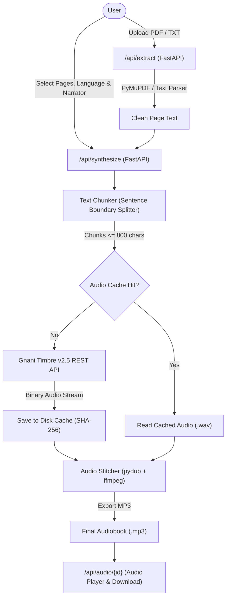

# KathaVaani (कथावाणी) 🎙️📖

> *A vintage-bookshop web app turning written literature into soulful audiobooks in native Indian languages, powered by Gnani Timbre v2.5.*

---

## 🌟 Overview

**KathaVaani** is designed for readers who prefer to listen in their mother tongue. Built with a warm, nostalgic old-bookshop aesthetic, KathaVaani enables listeners to upload books (PDF or TXT), select specific chapters or page ranges, confirm the original language, choose between distinctive narrator personas, and listen to seamlessly synthesized audiobooks.

There is **no translation step**—the literature is narrated faithfully in its authentic native language.

---

## 🏛️ System Architecture



---

## ✨ Features & Backend Core

1. **Text Extraction Engine (`/api/extract`)**
   - High-fidelity per-page text extraction from PDF using **PyMuPDF (`fitz`)**.
   - Direct UTF-8 decoding for TXT manuscripts.
   - Automatic detection for scanned/image-only PDFs lacking a digital text layer.
   - Cleans pagination noise, recurring headers, and hyphenated line-breaks.

2. **Sentence-Aware Text Chunking**
   - Respects Gnani Timbre's payload threshold (capped safely under 800 characters).
   - Intelligently splits at natural sentence delimiters across Latin and Indic scripts (periods `.`, exclamation `!`, question marks `?`, and Indic Purna Virama `।`).

3. **Gnani Timbre v2.5 TTS Integration**
   - Direct REST integration with `https://api.vachana.ai/api/v1/tts/inference`.
   - Sequential request throttling to respect Gnani's active request policies.
   - Automatic retries with exponential backoff and jitter on HTTP 429 (`RATE_LIMITED`) and transient 5xx errors.

4. **Persistent Disk Caching**
   - High-performance disk cache keyed by `SHA-256(chunk_text + language + voice)`.
   - Repeated requests and preview generations return instantaneously with zero API credit consumption.

5. **Audio Stitching via Pydub & FFmpeg**
   - Seamlessly joins individual synthesized sentence chunks.
   - Inserts natural inter-sentence pauses (250ms–350ms) for pleasant listening flow.
   - Exports compressed, browser-ready MP3 audio files.

6. **Voices & Narrators Lookup (`voices.json`)**
   - Maps 2 narrator personas across 10 Indian languages to verified Gnani voices:
     - **Kavya (Female Narrator)**: Warm, empathetic, and lyrical storytelling.
     - **Kabir (Male Narrator)**: Deep, resonant, and calm narration.

---

## 🌐 Supported Languages

| Language | Code | Default Female Voice | Default Male Voice |
| :--- | :--- | :--- | :--- |
| **English (Indian)** | `en-IN` | Nalini | Deepak |
| **Hindi** | `hi-IN` | Nalini | Deepak |
| **Telugu** | `te-IN` | Nalini | Deepak |
| **Tamil** | `ta-IN` | Nalini | Deepak |
| **Kannada** | `kn-IN` | Nalini | Deepak |
| **Malayalam** | `ml-IN` | Nalini | Deepak |
| **Marathi** | `mr-IN` | Nalini | Deepak |
| **Bengali** | `bn-IN` | Nalini | Deepak |
| **Gujarati** | `gu-IN` | Nalini | Deepak |
| **Punjabi** | `pa-IN` | Nalini | Deepak |

---

## 🚀 Quickstart Guide

### 1. Prerequisites
- Python 3.10+
- FFmpeg installed and available in system PATH

### 2. Environment Configuration
Create a `.env` file in the project root:
```env
GNANI_API_KEY=your_gnani_api_key_here
```
> **Security Notice**: Never commit `.env` or hardcode API keys.

### 3. Install Dependencies
```bash
pip install fastapi uvicorn requests python-dotenv pymupdf pydub
```

### 4. Prove Audio Synthesis (Standalone Test)
Run the test script to synthesize the full manuscript of `assets/books/sample.txt`:
```bash
python test_audio.py
```
This chunks the entire manuscript (3,813 characters, 666 words across all 7 speech chunks), synthesizes with Gnani Timbre v2.5, leverages the disk cache, and stitches them into a full master audiobook: `output_sample_audiobook.mp3` (~3.7 minutes duration, 4.4 MB).

### 5. Start Backend Server
```bash
uvicorn backend.main:app --host 127.0.0.1 --port 8000 --reload
```
Interactive API documentation is accessible at `http://127.0.0.1:8000/docs`.

---

## 📡 API Reference

### `POST /api/extract`
Upload a PDF or TXT file to extract text per page.
- **Request**: Multipart form data with `file`
- **Response**:
  ```json
  {
    "filename": "sample.txt",
    "total_pages": 1,
    "is_scanned": false,
    "pages": [
      {
        "page_number": 1,
        "text": "Extracted text content..."
      }
    ]
  }
  ```

### `POST /api/synthesize`
Synthesize selected pages into a single MP3 audiobook.
- **Request JSON**:
  ```json
  {
    "text": "Optional direct text override...",
    "pages": ["Page 1 text...", "Page 2 text..."],
    "language": "en-IN",
    "narrator": "female",
    "speed": 1.0
  }
  ```
- **Response**:
  ```json
  {
    "status": "success",
    "audio_id": "c1f7a4e2-...",
    "download_url": "/api/audio/c1f7a4e2-....mp3",
    "duration_seconds": 24.5,
    "chunks_processed": 4,
    "cache_hits": 2
  }
  ```

### `GET /api/voices`
Retrieve available narrators and supported languages.

### `GET /api/audio/{filename}`
Stream or download the stitched MP3 audiobook file.

---

## 🔒 Security & Best Practices
- Environment variables are isolated and loaded via `python-dotenv`.
- Uploaded files are processed in-memory / temporary sandboxes.
- API keys are excluded from logs, error payloads, and client responses.

